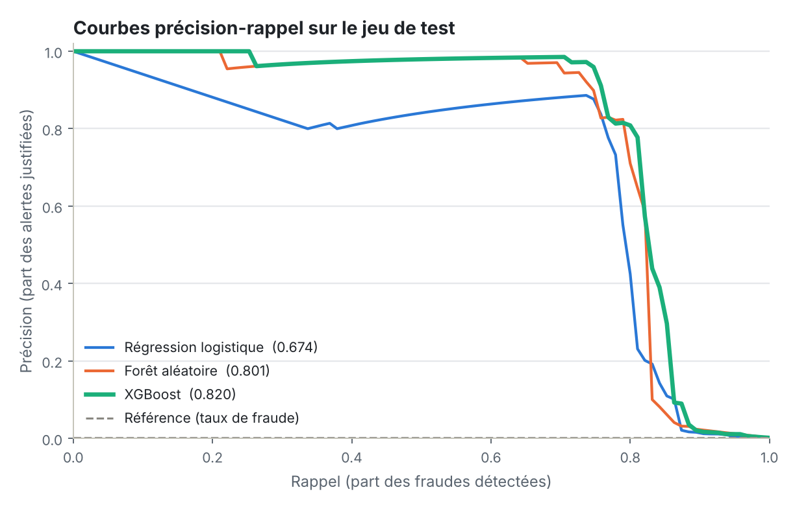
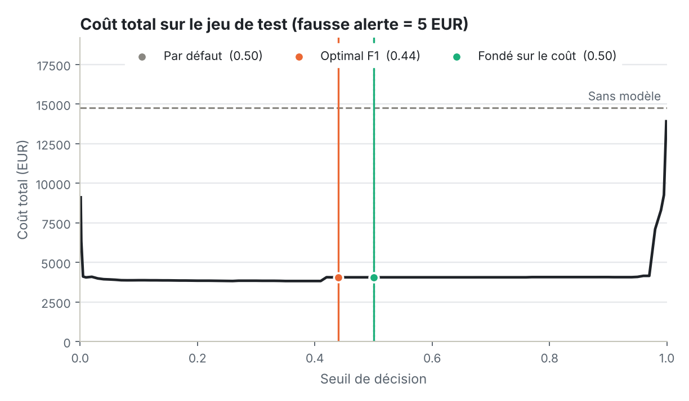
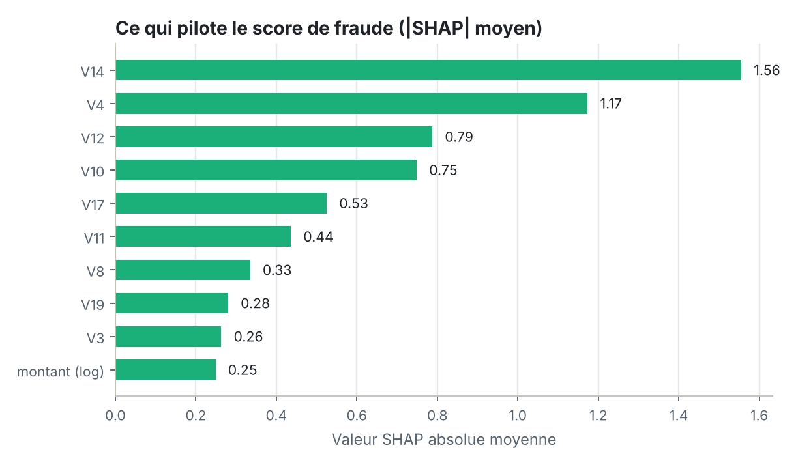

<div align="center">

# Détection de fraude à la carte bancaire

**Repérer 1 transaction sur 600 : un projet de machine learning de bout en bout sur un jeu de données très déséquilibré**

<p align="center"><a href="README.md"><picture><source media="(prefers-color-scheme: dark)" srcset="assets/buttons/lang_en_off_dark.png"></picture></a> <a href="README.fr.md"><picture><source media="(prefers-color-scheme: dark)" srcset="assets/buttons/lang_fr_on_dark.png"></picture></a></p>

<p align="center"><a href="https://aishwaryamarkandu.github.io/credit-card-fraud-detection/fr/"><picture><source media="(prefers-color-scheme: dark)" srcset="assets/buttons/report_fr_dark.png"></picture></a> <a href="https://aishwaryamarkandu.github.io/credit-card-fraud-detection/"><picture><source media="(prefers-color-scheme: dark)" srcset="assets/buttons/other_report_en_dark.png"></picture></a> <a href="fraud_detection.ipynb"><picture><source media="(prefers-color-scheme: dark)" srcset="assets/buttons/notebook_dark.png"></picture></a></p>

<p align="center"><picture><source media="(prefers-color-scheme: dark)" srcset="assets/buttons/tag_python_dark.png"></picture> <picture><source media="(prefers-color-scheme: dark)" srcset="assets/buttons/tag_sklearn_dark.png"></picture> <picture><source media="(prefers-color-scheme: dark)" srcset="assets/buttons/tag_xgboost_dark.png"></picture> <picture><source media="(prefers-color-scheme: dark)" srcset="assets/buttons/tag_shap_en_dark.png"></picture> <picture><source media="(prefers-color-scheme: dark)" srcset="assets/buttons/tag_mit_fr_dark.png"></picture></p>

</div>

---

## Présentation

La fraude est rare, et c'est précisément ce qui la rend difficile à détecter. Dans ce jeu de données, seules **0,17 %** des transactions sont frauduleuses (environ 1 sur 600) : un modèle qui accepte tous les paiements affiche donc **99,83 % d'accuracy sans arrêter la moindre fraude**.

Ce projet vise à faire le travail correctement : gérer le déséquilibre des classes, choisir des métriques qui ne mentent pas, et régler le seuil de décision en fonction de l'arbitrage réel entre **fraudes manquées** et **fausses alertes**.

> Le **rapport interactif** associé (en français et en anglais, mode clair et sombre) déroule toute l'analyse et permet de faire varier le coût d'une fausse alerte pour voir le meilleur seuil se déplacer.

## Résultats en un coup d'œil

Tous les chiffres proviennent de `fraud_detection.ipynb` et sont mesurés sur un jeu de test mis de côté qui ne contient que **95 fraudes** : à lire comme des ordres de grandeur (voir les intervalles).

| Modèle | PR-AUC en VC (défauts, 5 plis) | PR-AUC en VC (réglé, 3 plis) | PR-AUC en test [intervalle à 95 %] |
|---|---:|---:|---:|
| Référence (toujours légitime) | 0,0017 | – | 0,0017 |
| Régression logistique | 0,756 ± 0,027 | 0,755 | 0,674 [0,574–0,791] |
| Forêt aléatoire | 0,821 ± 0,035 | 0,822 | 0,801 [0,726–0,887] |
| XGBoost **(retenu)** | 0,854 ± 0,027 | 0,852 | 0,820 [0,756–0,900] |

Le modèle **XGBoost** a été choisi sur la validation croisée, jamais sur le jeu de test. Au seuil par défaut de 0,5, il atteint déjà 75 % de rappel et 97 % de précision, alors que la référence « tout accepter » affiche 99,83 % d'accuracy et un rappel nul.

**Où couper le score est une décision métier.** Les seuils ci-dessous sont choisis sur les prédictions « out-of-fold » de l'entraînement (le jeu de test reste intact) ; celui fondé sur le coût suppose qu'une fraude manquée coûte le montant de la transaction et qu'une fausse alerte coûte **5 €** (mon hypothèse, pas une mesure).

| Seuil | Valeur | Fraudes détectées | Fausses alertes | Alertes / 100 k tx | Fraude non détectée | Coût total |
|---|---:|---:|---:|---:|---:|---:|
| Par défaut | 0,50 | 71 / 95 (75 %) | 2 | 129 | 4 052 € | 4 062 € |
| Optimal F1 | 0,44 | 71 / 95 (75 %) | 2 | 129 | 4 052 € | 4 062 € |
| Fondé sur le coût | 0,50 | 71 / 95 (75 %) | 2 | 129 | 4 052 € | 4 062 € |

Avec cette hypothèse, les trois seuils prennent exactement les mêmes décisions sur le jeu de test : le modèle sépare assez bien les classes pour qu'un large plateau de seuils se comporte de la même façon. Le choix commence à compter quand le coût d'une fausse alerte change beaucoup : à 1 €, le seuil optimal sur le coût tombe à 0,005 et détecte 82 fraudes au lieu de 71, au prix de 302 fausses alertes au lieu de 2 (voir la section 5.3 du notebook, ou le curseur du rapport interactif).

<picture>
  <source media="(prefers-color-scheme: dark)" srcset="results/figures/readme/pr_curves_fr_dark.png">
  
</picture>

<picture>
  <source media="(prefers-color-scheme: dark)" srcset="results/figures/readme/threshold_cost_fr_dark.png">
  
</picture>

<picture>
  <source media="(prefers-color-scheme: dark)" srcset="results/figures/readme/shap_fr_dark.png">
  
</picture>

## Jeu de données

[Credit Card Fraud Detection](https://www.kaggle.com/datasets/mlg-ulb/creditcardfraud) (Kaggle, ULB Machine Learning Group) : de vraies transactions par carte de porteurs européens sur deux jours. La plupart des variables (`V1`–`V28`) sont des composantes PCA anonymisées ; seules `Time`, `Amount` et l'étiquette `Class` sont brutes.

* 284 807 lignes → **283 726** après suppression de 1 081 doublons exacts, dont **473** fraudes (0,17 %)
* Les données sont lues dans `data/creditcard.csv` si le fichier existe, sinon chargées directement avec `kagglehub` (voir [`data/README.md`](data/README.md))

## Déroulé du projet

1. **Nettoyage des données**
   * Vérification des valeurs manquantes (aucune)
   * Suppression des transactions en double pour qu'une même ligne ne se retrouve pas à la fois en entraînement et en test
2. **Analyse exploratoire**
   * Distribution des classes et ampleur du déséquilibre
   * Montants des transactions, fraude contre légitime
   * Comportement de la fraude selon l'heure de la journée
   * Corrélations entre variables et séparation des classes
3. **Feature engineering et préparation**
   * Montant des transactions passé au logarithme
   * Heure de la journée dérivée de l'horodatage
   * Découpage entraînement/test stratifié
   * Mise à l'échelle robuste ajustée sur l'entraînement uniquement (dans un `Pipeline`, donc réajustée à chaque pli de validation croisée)
4. **Modélisation**
   * Une référence « ne rien faire » à battre
   * Régression logistique, forêt aléatoire et XGBoost
   * Pondération des classes pour gérer le déséquilibre
   * Validation croisée stratifiée
   * Réglage des hyperparamètres par recherche aléatoire sur la PR-AUC
5. **Évaluation**
   * Précision, rappel et PR-AUC plutôt que l'accuracy
   * Courbes précision–rappel avec intervalles de confiance par bootstrap
   * Réglage du seuil : optimal F1 et fondé sur le coût, tous deux choisis sans toucher au jeu de test
   * Analyse des matrices de confusion
   * Importance des variables et explications SHAP, y compris pour des transactions individuelles

## Enseignements clés

* **L'accuracy récompense l'inaction.** Tout accepter donne 99,83 % et n'attrape aucune fraude.
* **Les arbres captent ce qu'un modèle linéaire rate.** La forêt aléatoire et XGBoost atteignent 0,801 et 0,820 de PR-AUC, contre 0,674 pour la régression logistique.
* **Le seuil est un choix métier, pas seulement technique.** Avec une fausse alerte très peu chère (1 €), le seuil optimal sur le coût s'effondre à 0,005 ; à partir d'environ 5 €, un large plateau de seuils se comporte presque de la même façon.
* **L'explicabilité compte quand la décision touche un vrai client.** SHAP montre quelle variable a déclenché chaque alerte, même si l'anonymisation des variables limite la portée de l'explication.

## Limites et prochaines étapes

* Le jeu de test ne contient que 95 fraudes : chaque métrique porte une vraie incertitude.
* **Validation temporelle** (entraîner sur le passé, tester sur le futur) pour se rapprocher de la production
* **Rééchantillonnage** de type SMOTE, comparé honnêtement à la pondération des classes
* **Calibration des probabilités**, pour que les scores se lisent comme de vraies probabilités et que les seuils se transposent d'une période à l'autre

## Lancer le projet

```bash
git clone https://github.com/AishwaryaMarkandu/credit-card-fraud-detection.git
cd credit-card-fraud-detection
pip install -r requirements.txt
jupyter notebook fraud_detection.ipynb
```

Reconstruire le rapport web et les figures du README après une nouvelle exécution du notebook :

```bash
python scripts/build_site.py      # écrit docs/index.html et docs/fr/index.html
python scripts/make_figures.py    # écrit results/figures/readme/*.png
```

**Publier le rapport :** sur GitHub, *Settings → Pages*, choisir *Deploy from a branch*, puis `main` et le dossier `/docs`.

## Structure du dépôt

```
├── fraud_detection.ipynb     # l'analyse complète (exécutée, avec ses sorties)
├── results/
│   ├── metrics.json          # tous les chiffres utilisés par le rapport
│   └── figures/              # figures du notebook + figures du README
├── docs/                     # GitHub Pages : index.html (EN) et fr/index.html (FR)
├── site/                     # source du rapport web (gabarit, CSS, JS, traductions)
├── assets/buttons/           # README button images (light + dark)
├── scripts/                  # build_site.py, make_figures.py, make_buttons.py
├── data/                     # y placer creditcard.csv (non versionné)
└── requirements.txt
```

## Stack technique

Python · pandas · scikit-learn · XGBoost · SHAP · matplotlib · seaborn

Testé avec Python 3.13, pandas 3.0, scikit-learn 1.9, XGBoost 3.4 et SHAP 0.54.

## Remerciements

Jeu de données du ULB Machine Learning Group et de Worldline, publié sur Kaggle ; voir sa page pour les conditions de licence. Code publié sous [licence MIT](LICENSE).

Réalisé par [Aishwarya Markandu](https://github.com/AishwaryaMarkandu).
