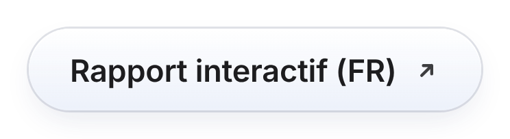
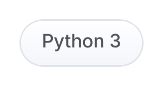
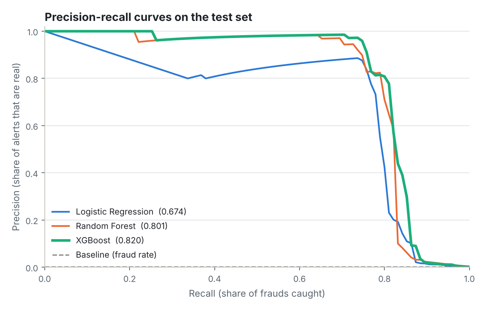
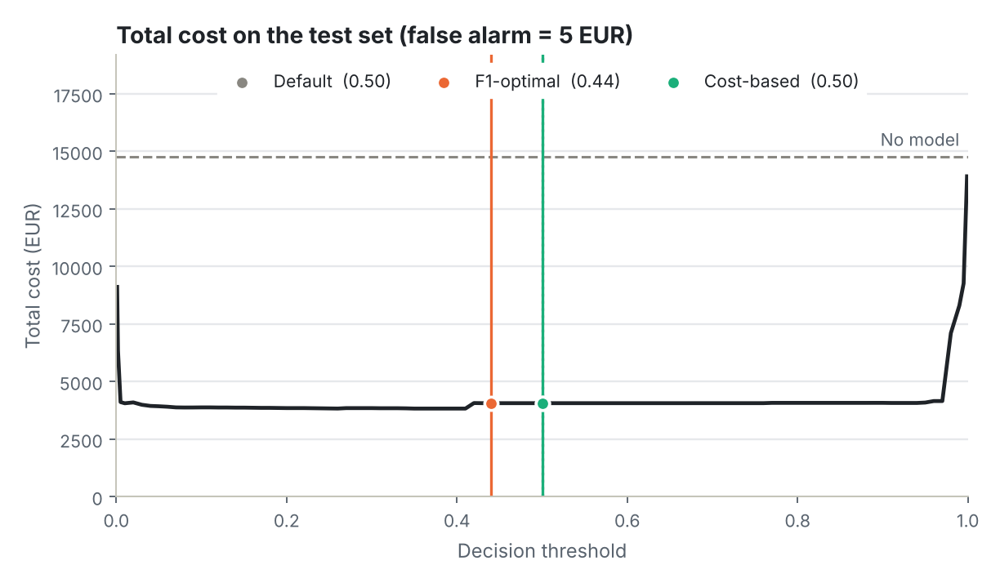
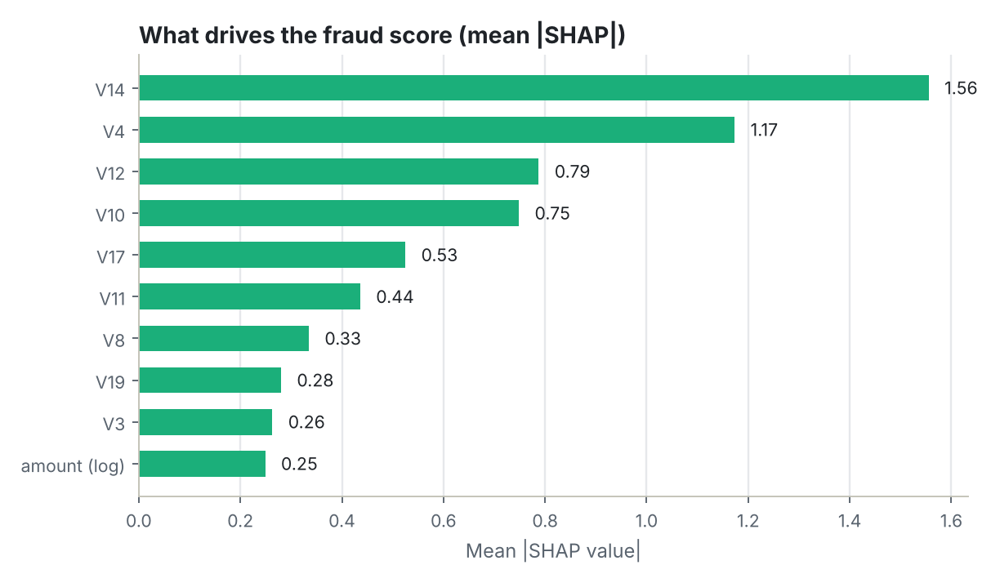

<div align="center">

# Credit Card Fraud Detection

**Catching the 1 in 600: an end-to-end machine learning project on a heavily imbalanced dataset**

<p align="center"><a href="README.md"><picture><source media="(prefers-color-scheme: dark)" srcset="assets/buttons/lang_en_on_dark.png"></picture></a> <a href="README.fr.md"><picture><source media="(prefers-color-scheme: dark)" srcset="assets/buttons/lang_fr_off_dark.png"></picture></a></p>

<p align="center"><a href="https://aishwaryamarkandu.github.io/credit-card-fraud-detection/"><picture><source media="(prefers-color-scheme: dark)" srcset="assets/buttons/report_en_dark.png"></picture></a> <a href="https://aishwaryamarkandu.github.io/credit-card-fraud-detection/fr/"><picture><source media="(prefers-color-scheme: dark)" srcset="assets/buttons/other_report_fr_dark.png"></picture></a> <a href="fraud_detection.ipynb"><picture><source media="(prefers-color-scheme: dark)" srcset="assets/buttons/notebook_dark.png"></picture></a></p>

<p align="center"><picture><source media="(prefers-color-scheme: dark)" srcset="assets/buttons/tag_python_dark.png"></picture> <picture><source media="(prefers-color-scheme: dark)" srcset="assets/buttons/tag_sklearn_dark.png"></picture> <picture><source media="(prefers-color-scheme: dark)" srcset="assets/buttons/tag_xgboost_dark.png"></picture> <picture><source media="(prefers-color-scheme: dark)" srcset="assets/buttons/tag_shap_en_dark.png"></picture> <picture><source media="(prefers-color-scheme: dark)" srcset="assets/buttons/tag_mit_en_dark.png"></picture></p>

</div>

---

## Overview

Fraud is rare, and that is exactly what makes it hard to catch. In this dataset only **0.17%** of transactions are fraudulent (about 1 in 600), so a model that approves every payment is **99.83% accurate while stopping no fraud at all**.

This project is about doing the job properly: dealing with the class imbalance, choosing metrics that do not lie, and tuning the decision threshold for the real trade-off between **missed fraud** and **false alarms**.

> The accompanying **interactive report** (English and French, light and dark mode) walks through the whole analysis and lets you move the cost of a false alarm to see the best threshold shift.

## Results at a glance

All numbers come from `fraud_detection.ipynb` and are measured on a held-out test set that holds only **95 frauds**, so treat them as indicative (see the intervals).

| Model | CV PR-AUC (defaults, 5 folds) | CV PR-AUC (tuned, 3 folds) | Test PR-AUC [95% interval] |
|---|---:|---:|---:|
| Baseline (always legit) | 0.0017 | – | 0.0017 |
| Logistic Regression | 0.756 ± 0.027 | 0.755 | 0.674 [0.574–0.791] |
| Random Forest | 0.821 ± 0.035 | 0.822 | 0.801 [0.726–0.887] |
| XGBoost **(chosen)** | 0.854 ± 0.027 | 0.852 | 0.820 [0.756–0.900] |

The **XGBoost** model was picked on cross-validation, never on the test set. At the default 0.5 threshold it already reaches 75% recall and 97% precision, while the "approve everything" baseline has an accuracy of 99.83% and a recall of 0.

**Where to cut the score is a business decision.** Thresholds below were chosen on out-of-fold training predictions (the test set stays untouched); the cost-based one assumes a missed fraud costs its transaction amount and a false alarm costs **€5** (my assumption, not a measured value).

| Threshold | Value | Frauds caught | False alarms | Alerts / 100k tx | Fraud lost | Total cost |
|---|---:|---:|---:|---:|---:|---:|
| Default | 0.50 | 71 / 95 (75%) | 2 | 129 | €4,052 | €4,062 |
| F1-optimal | 0.44 | 71 / 95 (75%) | 2 | 129 | €4,052 | €4,062 |
| Cost-based | 0.50 | 71 / 95 (75%) | 2 | 129 | €4,052 | €4,062 |

With this assumption the three thresholds make the same decisions on the test set: the model separates the classes well enough that a wide plateau of thresholds behaves alike. The choice starts to matter when the cost of a false alarm changes a lot: at €1, the cost-optimal threshold falls to 0.005 and catches 82 frauds instead of 71, at the price of 302 false alarms instead of 2 (see section 5.3 of the notebook, or move the slider in the interactive report).

<picture>
  <source media="(prefers-color-scheme: dark)" srcset="results/figures/readme/pr_curves_en_dark.png">
  
</picture>

<picture>
  <source media="(prefers-color-scheme: dark)" srcset="results/figures/readme/threshold_cost_en_dark.png">
  
</picture>

<picture>
  <source media="(prefers-color-scheme: dark)" srcset="results/figures/readme/shap_en_dark.png">
  
</picture>

## Dataset

[Credit Card Fraud Detection](https://www.kaggle.com/datasets/mlg-ulb/creditcardfraud) (Kaggle, ULB Machine Learning Group): real card transactions made by European cardholders over two days. Most features (`V1`–`V28`) are PCA components, anonymised for privacy; `Time`, `Amount` and the `Class` label are the only raw columns.

* 284,807 rows → **283,726** after removing 1,081 exact duplicates, of which **473** are fraud (0.17%)
* The data is read from `data/creditcard.csv` when present, otherwise loaded directly with `kagglehub` (see [`data/README.md`](data/README.md))

## Project workflow

1. **Data cleaning**
   * Checked for missing values (none)
   * Dropped duplicate transactions so the same row cannot land in both train and test
2. **Exploratory data analysis**
   * Class distribution and how extreme the imbalance is
   * Transaction amounts, fraud vs legit
   * Fraud behaviour by hour of day
   * Feature correlations and class separation
3. **Feature engineering and preparation**
   * Log-transformed transaction amount
   * Hour of day derived from the timestamp
   * Stratified train/test split
   * Robust scaling fitted on the training data only (inside a `Pipeline`, so it is re-fitted in every CV fold)
4. **Modelling**
   * A do-nothing baseline to beat
   * Logistic Regression, Random Forest and XGBoost
   * Class weighting to handle the imbalance
   * Stratified cross-validation
   * Hyperparameter tuning with randomized search on PR-AUC
5. **Evaluation**
   * Precision, recall and PR-AUC instead of accuracy
   * Precision–recall curves with bootstrap confidence intervals
   * Threshold tuning: F1-optimal and cost-based, both chosen without touching the test set
   * Confusion matrix analysis
   * Feature importance and SHAP explanations, including single-transaction explanations

## Key takeaways

* **Accuracy rewards doing nothing.** Approving everything scores 99.83% and catches no fraud.
* **Trees capture what a linear model misses.** Random Forest and XGBoost reach 0.801 and 0.820 PR-AUC, against 0.674 for Logistic Regression.
* **The threshold is a business choice, not just a technical one.** With a very cheap false alarm (€1) the cost-optimal threshold collapses to 0.005; from about €5 upwards a wide plateau of thresholds behaves almost the same.
* **Explainability matters when a decision lands on a real customer.** SHAP shows which feature drove each alert, although anonymised features limit how far that explanation can go.

## Limits and next steps

* The test set contains only 95 frauds: every metric carries real uncertainty.
* **Time-based validation** (train on the past, test on the future) to mimic production
* **Resampling** techniques such as SMOTE, compared honestly against class weights
* **Probability calibration**, so scores read as true probabilities and thresholds transfer between periods

## Run it

```bash
git clone https://github.com/AishwaryaMarkandu/credit-card-fraud-detection.git
cd credit-card-fraud-detection
pip install -r requirements.txt
jupyter notebook fraud_detection.ipynb
```

Rebuild the web report and README figures after re-running the notebook:

```bash
python scripts/build_site.py      # writes docs/index.html and docs/fr/index.html
python scripts/make_figures.py    # writes results/figures/readme/*.png
```

**Publish the report:** on GitHub, go to *Settings → Pages*, choose *Deploy from a branch*, then `main` and the `/docs` folder.

## Repository structure

```
├── fraud_detection.ipynb     # the full analysis (executed, with outputs)
├── results/
│   ├── metrics.json          # every number used by the report
│   └── figures/              # notebook figures + README figures
├── docs/                     # GitHub Pages: index.html (EN) and fr/index.html (FR)
├── site/                     # source of the web report (template, CSS, JS, translations)
├── assets/buttons/           # README button images (light + dark)
├── scripts/                  # build_site.py, make_figures.py, make_buttons.py
├── data/                     # put creditcard.csv here (not versioned)
└── requirements.txt
```

## Tech stack

Python · pandas · scikit-learn · XGBoost · SHAP · matplotlib · seaborn

Tested with Python 3.13, pandas 3.0, scikit-learn 1.9, XGBoost 3.4 and SHAP 0.54.

## Acknowledgements

Dataset by the ULB Machine Learning Group and Worldline, published on Kaggle; see its page for licence terms. Code released under the [MIT license](LICENSE).

Built by [Aishwarya Markandu](https://github.com/AishwaryaMarkandu).
